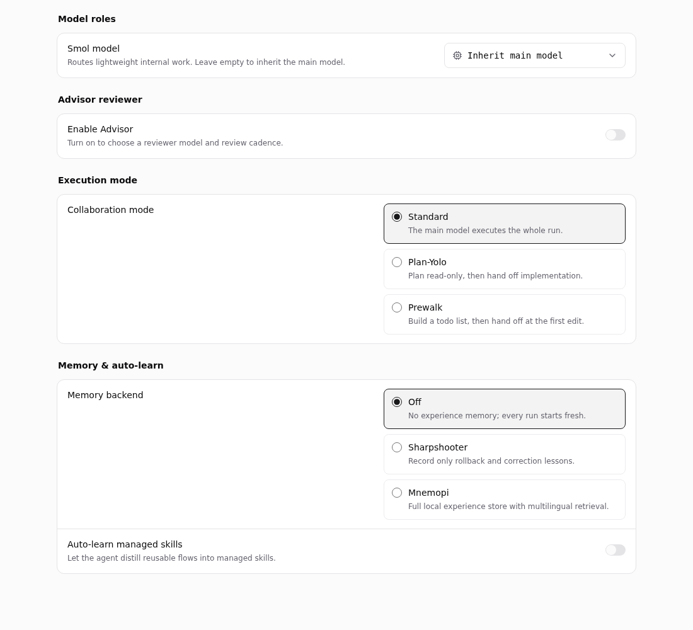
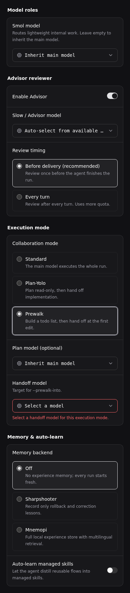
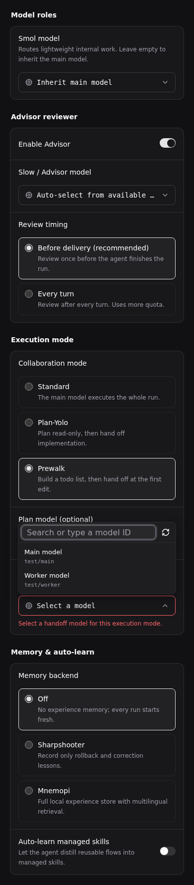
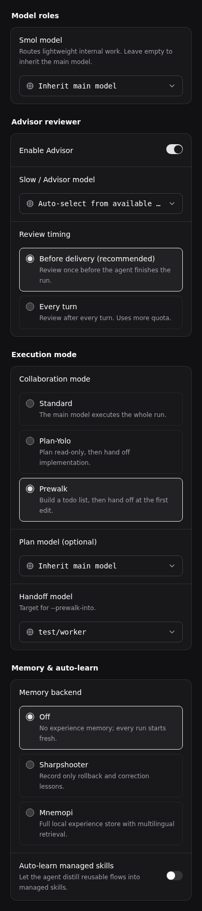
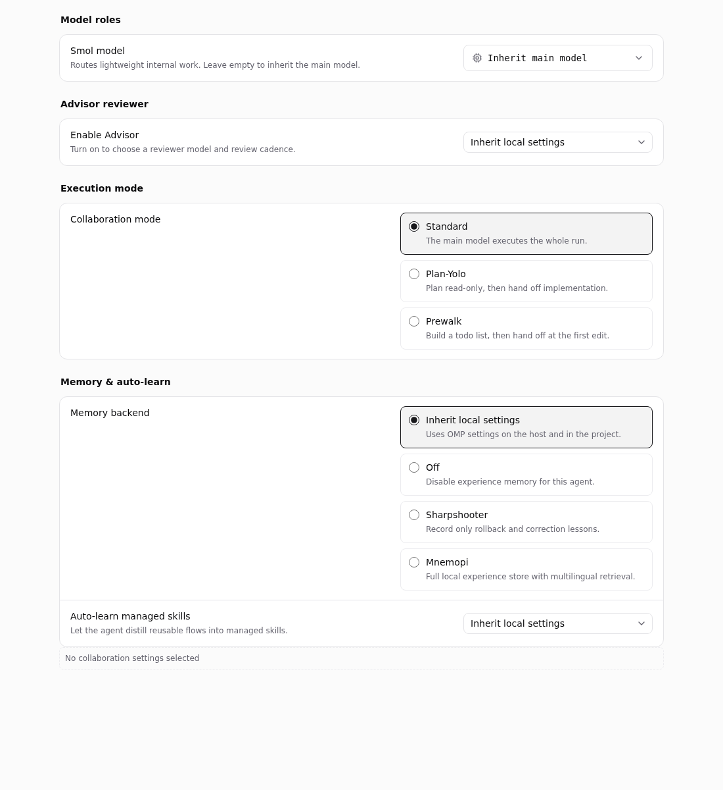
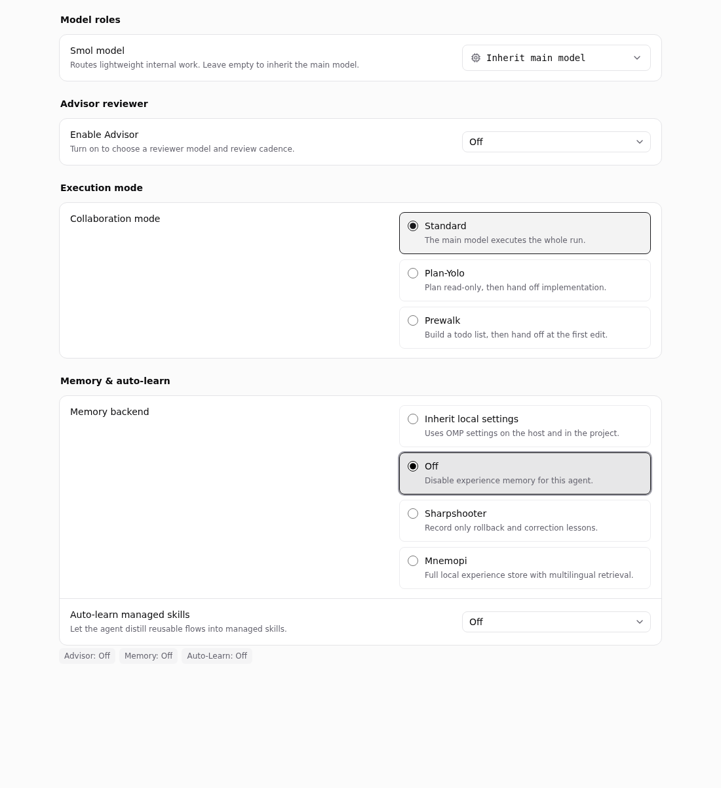
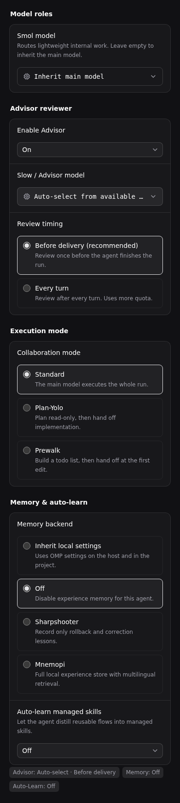

# F13：OMP 运行时与协同配置治理（OL-1280）

审视结论：保留 OMP 集成和四组协同配置，继续复用上游 Pi 后端。已修复启动失败目录泄漏、默认值脏检查不一致，并校正 overlay 失败日志。Master 已批准方案 A：未配置继续继承本地设置，显式关闭持久化并写入否定 overlay；Advisor 开启后的缺省审阅频次统一为 agent-end。前后端、交互、五语言文案及回归测试已同步，无新表、迁移或功能下线。

审视快照：2026-11-08，`origin/main` = `e31506b3c8eb47cd8694e3bfe160856d6c12a27a`。主比较基线为官方 `v0.8.1` = `b1ea927def6490c43bedff537b6f4ed9a47fa828`；另核对 `v0.8.0` = `9b1ab4f9eed9153a94719596eb8a728d2770f065`。这是源码、假 CLI 进程测试、真实 React 组件截图的组合审视；未运行用户安装的真实智能体 CLI，未使用生产账号或数据库。

## ① 必要性与上游重叠

| 能力 | v0.8.0 / v0.8.1 覆盖 | Fork 增量与处置 |
| --- | --- | --- |
| OMP 注册、独立可执行文件、模型发现、skill 路径 | 两版 `builtin_runtimes.go` 已有 `omp` 描述符，复用 `pi` 协议；`discoverOmpModels` 使用 `omp models --json` | 保留复用，不另建后端 |
| JSON 流、stdin 提示词、fresh/resume、会话锁、超时、进程清理 | 已覆盖；`omp_session.go`、`pi_cleanup*.go` 已存在 | 不将基础生命周期误记为 Fork 新增，不重复建设 |
| 智能体独立的角色模型和协同模式 | 上游有通用 `custom_args`，但没有此次九字段 schema 和四组表单 | 部分底层重叠；可视配置、校验和 quota 归属仍有独立价值 |
| Advisor 节奏、记忆后端、auto-learn | 上游可间接通过外部 OMP 配置使用，未提供本面板及托管 overlay | 保留显式配置能力，先解决缺省/关闭契约 |
| quota 中的角色提供商归属 | OMP 角色字段是 Fork 新增输入 | 保留 `servingAccountPoolProviders` 复用，避免隐藏角色误计账号池 |

基本启动、取消与续跑是运行时正确性的核心路径。角色模型、Advisor、计划交接和记忆属于可选能力；仓库没有采用率、请求量或成本分布证据，不能据此声称它们是高频刚需，也不能判定为低价值实验并删除。当前不存在应将整套 OMP 面板合并进上游通用配置的充分依据。

## ② 侵入面与逐文件核对

审视起点 main 快照中，任务直接列出的五文件相对 v0.8.1 合计 **+913/-2**：

| 文件 | 差异 | 审视结果 |
| --- | --- | --- |
| `server/pkg/agent/omp_runtime.go` | +253/-0，新文件 | 九字段解码、枚举降级、角色 flag 门控、custom_args 优先、固定 YAML overlay；无数据库或后台缓存 |
| `server/pkg/agent/omp_session.go` | +14/-1 | 在上游会话参数构造后插入 overlay 与托管参数；session 参数仍归 daemon 所有 |
| `server/pkg/agent/pi.go` | +1/-1 | 快照中的 Fork 差异仅 MCP 错误品牌文本；生命周期主体来自上游。本次 A 类修复额外增加 fresh OMP 启动失败清理 |
| `packages/core/agents/omp-runtime-config.ts` | +153/-0，新文件 | schema/parse/serialize/equals/handoff 校验/九字段剥离；发现默认枚举与缺省值比较不一致，已修 |
| `packages/views/agents/components/omp-runtime-config.tsx` | +492/-0，新文件 | 四组配置、共用 ModelPicker、语义化单选组与摘要；无自建 store、请求循环或 effect |

为避免低估接线成本，另按五个功能提交 `57d9cfb3e`、`94be95b6f`、`2ba32c436`、`6a9bafeb0`、`f9cffdf2f` 的文件并集统计：38 文件，加上任务指定的 `pi.go`，审视边界共 **39 文件**。其中后端/daemon 生产文件 5、Go 测试 1；core 生产文件 7、测试 5；views 生产文件 9、测试 7、语言资源 5。**数据库迁移 0、专属 SQL 0、CLI 命令文件 0**。这些公共文件还承载其他 Fork 功能，不能把它们的全部行差归给 F13。

完整增量接线清单如下（上面五文件之外）：

| 位置 | 文件 | 核对点 |
| --- | --- | --- |
| `server/pkg/agent/` | `agent.go`、`omp_runtime_test.go` | ExecOptions 传递可选指针；解码、argv、overlay、覆盖优先级断言 |
| `server/internal/daemon/` | `daemon.go` | 仅 provider=omp 时解码 `task.Agent.RuntimeConfig`，传给既有执行链；不额外取库 |
| `packages/core/agents/` | `index.ts`、`draft.ts`、`stored-draft.ts` | 统一导出；复制只保留可用 OMP runtime 的配置；创建按目标 provider 序列化；草稿持久化 |
| `packages/core/agents/` | `builder-protocol.test.ts`、`draft.test.ts`、`stored-draft.test.ts`、`omp-runtime-config.test.ts` | 草稿默认值、复制、非 OMP payload 剥离、配置往返 |
| `packages/core/` | `api/schemas.ts`、`types/agent.ts` | 创建请求可携带 runtime_config，复用原 JSONB/响应 schema |
| `packages/core/runtimes/` | `plan-quota.ts`、`plan-quota.test.ts` | 仅启用的 slow/plan/handoff 参与账号池归属 |
| `packages/views/agents/components/` | `agent-detail-inspector.tsx`、`agent-detail-inspector.omp.test.tsx` | 650ms 串行自动保存；handoff 缺失禁止保存；切换智能体/runtime 重置草稿 |
| 同上 | `agent-properties-panel.tsx`、`agent-properties-panel.test.tsx` | provider 门控的配置摘要 |
| 同上 | `create-agent-dialog.tsx` | 复制预填、OMP 条件 payload、提交前 handoff 校验 |
| 同上 `inspector/` | `model-picker.tsx`、`use-execution-controls.ts` | 共用模型缓存；runtime 切换在同一个 PATCH 中清 model/thinking/tier 与 OMP 专属字段 |
| 同上 | `omp-runtime-config.test.tsx` | 四组显示、开关、handoff 告警、只读与摘要覆盖 |
| `packages/views/agents/create/` | `agent-configuration-panel.tsx`、`use-create-agent-form.ts` | 新创建流程接入；目标 provider 控制校验 |
| 同上 | `agent-execution-overrides.test.tsx`、`builder-setup.test.tsx`、`use-create-agent-form.test.tsx` | 创建/草稿接线与 handoff 回归 |
| `packages/views/runtimes/components/` | `account-pool-filter.ts`、`account-pool-filter.test.ts` | 复用 core 的角色提供商判断，不复制一套业务逻辑 |
| `packages/views/locales/` | `en/agents.json`、`fr/agents.json`、`ja/agents.json`、`ko/agents.json`、`zh-Hans/agents.json` | 五语言相同配置组与校验键 |

未发现新增冗余表、第二套模型缓存或不可达角色配置。`Choice` 的两个薄包装仅携带类型，不值得为了减少几十行新增通用表单框架。修复沿用现有 parse/serialize、equals、overlay 与 Execute 所有权机制；三态选择复用共享 Select 和现有单选卡，不新增表单状态层或其他 provider 的生命周期设计。

## ③ SQL、daemon 性能与资源生命周期

### SQL 路径

本功能不引入 SQL；对实际复用路径逐项检查如下。下列执行计划均为按 SQL 和索引定义的推演，**不是生产 EXPLAIN 实测**。

| SQL / 路径 | 谓词及推演 | 结论 |
| --- | --- | --- |
| `CreateAgent`，`queries/agent.sql` | 单行 INSERT，runtime_config 作为一个 JSONB 参数 | 角色数不增加 INSERT 数，无 JSON 展开/N+1 |
| `GetAgentInWorkspace` / `GetAgent` | agent 主键 id；前者再验 workspace/kind | 主键 Index Scan，最多一行；访问授权仍走现有 handler |
| `UpdateAgent` | `WHERE id=$1`；`runtime_config=COALESCE(parameter,runtime_config)` | 主键定位后更新一行，有正常行锁；非 JSON 路径扫描/批量锁 |
| `ListAgents` | workspace、未归档、kind，按 created_at 排序 | 复用 workspace 索引，可能对该工作区结果排序；面板不按角色重跑列表 |
| `GetAgentRuntimeForWorkspace`，`queries/runtime.sql` | runtime 主键 id + workspace | 主键定位后过滤 workspace，创建/绑定时沿用 |
| `GetAgentRuntime` | `WHERE id=$1` | 模型发现 POST/状态 GET 的权限路径经 runtimeLookup 读取单个 runtime，冷读使用主键 |
| `GetMemberByUserAndWorkspace`，`queries/member.sql` | user_id + workspace_id | 使用现有 `(workspace_id,user_id)` 唯一索引校验成员身份 |
| 模型请求状态、catalog | `ModelListStore` / catalog store（内存或 Redis） | 不为四个角色各建一套数据库查询；状态轮询仍有既有 runtime/成员授权成本 |
| 执行派发 | daemon 直接解码已领取任务中的 RuntimeConfig | 每次运行一次 O(九字段) 解码，无新增数据库往返 |

本边界没有新增 CTE、递归查询、相关子查询或 JSONB 筛选谓词，因此没有 OL-1263 式 CTE 剪枝对象，也不需要为了九个配置值添加 GIN 索引。未启动数据库环境；不将源码推演写成实测延迟或“全仓库无慢 SQL”。

### 参数逐项映射

| wire 字段 | 运行时映射/门控 |
| --- | --- |
| `smol_model` | `--smol` |
| `slow_model` | 仅 advisor_enabled 时 `--slow` |
| `plan_model` | 仅非 standard 执行模式时 `--plan` |
| `handoff_model` | `--plan-yolo-into` 或 `--prewalk-into` |
| `advisor_enabled` | 未设置不写；true 加 `--advisor` 并写 `advisor.enabled: true`；false 写 `advisor.enabled: false`，不传 slow/advisor flag |
| `advisor_review_mode` | Advisor 显式开启时写 `advisor.reviewMode`；未指定或无效值默认 `agent-end`；显式 `turn` 保留 |
| `execution_mode` | `plan_yolo` / `prewalk` 对应 CLI flag；standard 归一化为空 |
| `memory_backend` | off/sharpshooter/mnemopi 均写 YAML；mnemopi 另设项目标签作用域与多语言嵌入；未设置继承 |
| `autolearn_enabled` | true 写 enabled 与 autoContinue；false 写 `enabled: false`；未设置继承 |

模型字符串先 trim，前导 `-` 被 daemon 拒绝；枚举白名单过滤；JSON 类型错误整份 fail-soft。前端按字段容错而 daemon 在类型错误时忽略整份配置，这是已有宽松 API 合约，不在本次改为拒绝派发。API 创建先检查必要字段、runtime 权限、custom_args 等，再保存通用 runtime_config；OMP 特定值在 daemon 解码，不承诺 API 会拒绝每个无效 OMP 值。

custom_args 中同名 `--flag=value` / `--flag value` 优先；`--no-prewalk` 抑制托管 prewalk 及其 handoff。会话选择参数先过滤，不能用 custom_args 越过 daemon 的 session 所有权。显式 `--config` 会使托管 overlay 的同名 flag 让位，三种托管 YAML 设置一起不注入；这是已有覆盖规则，不能无声改成合并优先级。

### 生命周期和代价

- 启动前：拒绝空提示词，检查可执行文件与清理能力；fresh OMP 创建私有目录，resume 对已有 transcript 加锁。OMP 跳过 Pi 专用 MCP 临时扩展，不会因此制造多余 extension 目录。
- 启动后：上下文覆盖超时/取消；stdin 与 stdout 并行，写完关闭 stdin；stderr 有独立消费与有限尾部。session/result 通道有限缓冲，不靠无限队列保活。
- 回收：沿用 `piRunCleanup`，默认 TERM 宽限 2s、清理预算 10s；Linux 保留 pidfd 身份，Darwin/Windows 走对应实现。工具执行期间每 500ms 做一次进程观察，取消时 20ms 检查；进程树扫描随主机进程数/树深增长，但属于上游通用机制，本增量没有加轮询器。
- 协议错误：保留 10min 恢复窗口以允许 provider 自动重试，未完成工具不会被错误计时器直接裁断；stream/Wait/pipe/锁在结果发布前收敛。正常完成的合法后台服务按既有测试保留；不是把所有存活子进程都算泄漏。
- 模型发现：`discoverOmpModels` 使用 15s 上下文与 owned process 输出路径；使用现有发现缓存，没有专属常驻 OMP worker。
- overlay：最多一个固定名小 YAML，以 0600 创建，fresh 写入私有目录，resume 写到 transcript 同目录。会话必须留供续跑，overlay 也保留并按需重写；无配置时不传旧文件。原注释暗示“无需清理”过于笼统，已更正。
- **已复现并修复**：Cwd 无效等启动失败发生在目录/overlay 写出之后、子进程创建之前；每次失败遗留一个 `omp-*` 目录。新 defer 只删除本次创建且尚未启动的目录；成功启动的目录、resume 目录均不删除。失败后的 resume 锁仍可重新获取。进程已启动但没有 transcript 的失败运行不自动删目录，以免丢失诊断/伴生文件；会话保留策略不在本次扩大。

## ④ 前端性能与体验

### 数据与渲染

创建请求只在目标 provider=omp 时带 OMP 配置；创建草稿可以保留编辑内容，但提交到其他 provider 时不会泄漏这些字段。编辑页切换 runtime 使用一个 PATCH 清理九个 OMP 字段，同时保留其他 provider/中性键；详情草稿随 agent.id/runtime_id 重置。

面板最多四个角色 ModelPicker，加主模型/思考设置等共用同一 `runtimeModelsKeys.forRuntime(runtimeId)`。React Query 共享进行中的请求；成功实时目录 staleTime=5min、gcTime=30min，服务端缓存快照 staleTime=0 以避免叠加陈旧窗口。不存在每个字段单独 invalidate 模型目录的 effect。

发现期间每 500ms 查询一次状态，客户端总预算 100s（30s pending +60s running +10s 余量），约 200 次状态查询预算；完成后停止，不是常驻轮询。切换/卸载没有向 resolver 传 AbortSignal，所以已发起发现仍可能继续到完成/预算边界；这是共享模型发现机制的剩余成本，不是新增四倍轮询。手动刷新重用同一个 key。

列表 filter 使用 useMemo，目录数组引用稳定；打开菜单仍是 O(N) 渲染，没有虚拟化。没有真实大目录或用户规模数据，不能据此宣称卡顿，也不新增索引或虚拟列表。最多四个角色选择器的客户端计算与同一份目录长度线性相关。

自动保存复用 650ms debounce 与串行队列。**已修复**：standard 在 serialize/parse 中归一化为 undefined，equals 也按同一默认值比较。memory=off 和两个 false 现在保留原值，并与 undefined 区分：关闭和恢复继承都能触发保存，保存往返后不再误判为脏。详情页回归断言：关闭只提交一次、服务器回填后不重复提交、恢复继承清除三个键且保留其他配置。

### 截图步骤与可访问性

测试页挂载真实 `OmpRuntimeConfigPanel`、ModelPicker、共享主题样式和 i18n，QueryClient 预置两个无账号的测试模型。以下截图均挂载真实组件，已逐张打开检查。不是生产界面，也没有模拟服务器保存成功。1–4 为 B 类修改前的审视证据；5–7 展示批准方案后的交互。

1. 默认配置，1100px 浅色：四组清晰，关闭的 Advisor 隐藏 slow/review 配置；此时默认关闭与继承混淆，见下节根因。

   

2. 开启 Advisor、选择 Prewalk，390px 暗色：缺失 handoff 时输入边框与文字提示同时出现；内容换行、未见横向页面溢出。

   

3. 打开 handoff 模型选择器：搜索框有可访问名称，两个缓存模型可选；菜单位于可用空间内。

   

4. 选择 `test/worker`：值显示，必填告警消失；暗色边框、选中圆点、文本能区分状态。

   

5. 修改后默认配置，1100px 浅色：Advisor、Memory、Auto-learn 均明确显示继承本地配置，未操作时不生成关闭值。

   

6. 直接将三项选为 Off：不经过临时开启，表单持有 false/off/false，摘要展示三项关闭。

   

7. 390px 暗色启用 Advisor：默认选中 Before delivery（agent-end），其余两项仍保持显式关闭。

   

几何检查：390/640/768/1100px 时 document.scrollWidth 均等于 viewport 宽度。单选项是原生 radio，有分组名和 useId 隔离；Select、ModelPicker 有 accessible name；必填错误使用 `role=alert` 和 `aria-invalid`，只读状态禁用控件。加载 spinner、空目录、手动输入 fallback 从组件与已有测试核对；截图没有覆盖真实网络失败、全部翻译、200% 缩放或屏幕阅读器。未测量 WCAG 对比度，不声称完整无障碍合规。

## ⑤ A/B 分级处置

### A 类：本次已落地

| 项目 | 根因与改动 | 核心回归断言 |
| --- | --- | --- |
| fresh OMP 启动失败泄漏 | 创建目录后缺少启动失败所有权释放；在 Execute 返回失败前回收该新目录 | 连续失败两次目录为空；resume transcript 字节不变且锁释放；原 fresh→resume 用例仍通过 |
| 默认值脏检查 | equals 与 parse/serialize 表示不同；standard 保持默认归一化，off 按批准的 B 类契约持久化 | standard/off/false 保存往返在两个方向均相等；显式关闭与未配置不等 |
| overlay 诊断 | memory/auto-learn 失败也仅提示 Advisor review 丢失 | 日志明确指向整个 managed settings overlay；注释准确说明保留与清理边界 |

### B 类：已批准并落地的关闭与默认频次契约

根因：原 parse/serialize 把 `advisor_enabled:false`、`memory_backend:"off"`、`autolearn_enabled:false` 丢弃为 `{}`；daemon 同样不写否定值。本地或项目配置已开启功能时，面板显示关闭并不能关闭运行时。另有旧数据只存 `advisor_enabled:true` 时，面板显示 agent-end，但 overlay 不指定频次，运行时可能继承 turn。

Master 于 2026-11-08 确认“方案 A，按推荐执行”，研发组长要求在 PR #260 上完成该契约。最终规则如下：

| 输入 / 操作 | 保存与执行行为 | 核心回归断言 |
| --- | --- | --- |
| 未配置 / 恢复继承 | TS undefined、Go nil 布尔指针或空 memory；不写该设置，保留历史本地继承 | 空、null、无关 payload 不注入 overlay；面板显示继承且可从关闭恢复继承 |
| 显式关闭 | false/off 原样保存；overlay 写 advisor.enabled=false、memory.backend=off、autolearn.enabled=false | 三项单独关闭、同时关闭、混合开启均生成预期 YAML；关闭 Advisor 不注入 slow/advisor flag |
| Advisor 开启但频次缺省 | overlay 明确写 enabled=true、reviewMode=agent-end | 缺省/无效频次均为 agent-end；显式 turn 不变 |
| 保存、复制、创建 | 复用现有 JSONB、草稿和 PATCH；关闭值不被剥离 | TS 往返、持久草稿、复制后创建、详情页自动保存覆盖 |
| 续跑 | 同一 overlay 重写为当前配置；清除所有托管设置后不再引用旧文件 | 开启→关闭不残留 reviewMode、mnemopi、autoContinue；transcript 字节不变 |

面板的 Advisor 和 Auto-learn 改为共享 Select，提供继承/开启/关闭三个选项；Memory 沿用单选卡并增加继承。用户可直接关闭继承项，无需先开启再关闭。摘要显示显式关闭，空状态改为未设置，避免冒充本地配置的实际状态。五份已有 OMP 语言资源同步更新。

OMP 官方说明配置按内置、全局/profile、项目、overlay、运行时逐层覆盖；缺少键代表继承。这支持显式否定 overlay 的实现。[OMP Settings](https://omp.sh/docs/settings)（读取于 2026-11-08，未代替安装版实测。）

已有高优先级 custom_args 合约保持：显式 `--config` 仍使托管 overlay 让位，显式 CLI 参数也可覆盖设置；overlay 写失败仍告警后按既有 fail-soft 路径启动。本次没有改为强制启动失败或重排配置优先级。

## 验证记录与边界

- 修复前新增回归：A 类三个默认值往返失败、Go 启动失败残留目录；B 类三个关闭值往返失败、Go 关闭配置与 Advisor 缺省频次 overlay 断言失败。修复后通过。
- core 五文件：139 项通过（OMP 配置、draft、stored-draft、plan-quota、runtime models）。
- views 六文件：54 项通过（OMP 面板、详情保存、properties、创建校验、ModelPicker、account-pool-filter）。
- A 类修复阶段：`GOTOOLCHAIN=auto go test -race ./pkg/agent -run 'Pi|Omp|OMP|TestCodexExecuteLegacyFirstTurnMessageSatisfiesProgress' -count=1 -json`：138 个顶层用例通过，含子用例共 222 条通过记录；1 个独立进程 helper 按设计 skip，无 race 报告。
- B 类修复后：`GOTOOLCHAIN=auto go test -race ./pkg/agent -run 'Omp|OMP' -count=1 -json`：43 个顶层用例、含子用例共 78 项通过，无 race 报告。
- `go vet ./pkg/agent`、core/views typecheck、修改的 TS 文件 ESLint、`git diff --check` 通过。使用 go.mod 要求的自动 Go 工具链，未修改版本声明。
- **全包 race 未全绿**：`go test -race ./pkg/agent -count=1` 在本容器 Linux 5.15 的 Cursor pidfd 进程组能力上报 invalid argument，涉及三个 capture 用例和 CursorBackgroundLifecycle 四个子用例；同样失败在未修改 `e31506b3c` worktree 复现。另一次全包执行中 Codex 的 100ms inactivity 用例超时，单独在修改分支与基线运行均通过，保留为负载时序失败记录，不声称已修复。
- 本次未修改 Cursor/Codex，不通过放宽测试掩盖环境问题。未跑需要数据库环境的 make test、生产 E2E、真实智能体 smoke 或 Windows/macOS 执行测试；SQL 只有计划推演。截图测试进程与浏览器均已关闭。

可复跑的前端命令：

```sh
pnpm --filter @multica/core exec vitest run agents/omp-runtime-config.test.ts agents/draft.test.ts agents/stored-draft.test.ts runtimes/plan-quota.test.ts runtimes/models.test.ts
pnpm --filter @multica/views exec vitest run agents/components/omp-runtime-config.test.tsx agents/components/agent-detail-inspector.omp.test.tsx agents/components/agent-properties-panel.test.tsx agents/create/use-create-agent-form.test.tsx agents/components/inspector/model-picker.test.tsx runtimes/components/account-pool-filter.test.ts
pnpm --filter @multica/core typecheck
pnpm --filter @multica/views typecheck
```
