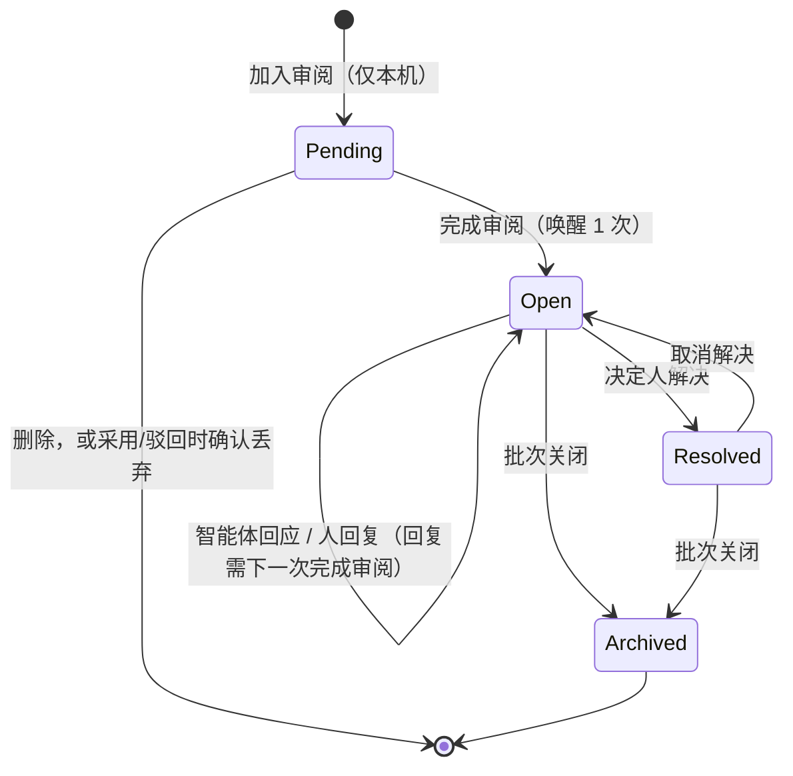

# 基线批注：交互心流、上下文隔离边界与数据传递格式

OL-1230 定稿（v1.3）的落盘版。基线批注是负责人针对某章某一修订版本写下的修订指令；它不是决定，只有被采用的修订版本才是项目权威。批注只交给一个承载任务里的一个智能体，**不进入任何其他运行的上下文**。

- 术语以根目录的 [`GLOSSARY.md`](../../GLOSSARY.md) 为准。
- 实现分工：P0 契约修复（OL-1241，PR #231）、P1 服务端迁移与接口（OL-1242，PR #232）、P2 CLI 与文档（OL-1243）、P3a/P3b 前端。本文与已合入的代码不一致时视为缺陷。
- 数据迁移实际落盘为 **`9059_labrastro_baseline_annotations`** 至 **`9063_labrastro_baseline_review_batch_index`** 五个文件（设计稿编号 `9049–9053`，因 main 在 P1 审阅期间合入其它迁移顺延）。

## 1. 结论摘要

1. **批注不是决定。** 批注只交给一个承载任务里的一个智能体，不进入任何其他运行的上下文。
2. **常规任务的上下文传导为 0 字节。** `resolveClaimProjectContext` / `appendEngineeringProjectDescription` 不读批注表，也不加状态行；用测试保证写入批注前后的 Project Context 逐字节一致。
3. **人的审阅界面采用成熟形态。** 阅读正本用 Word 式右侧批注栏，审阅候选用 GitHub 式行级 Diff 批注；两种模式共用一套批注模型和一套提交方式。
4. **防唤醒风暴：先挂起、后提交。** 新批注一律是「待提交」，只存在本机；「完成审阅」一次提交全部待提交批注，每次最多唤醒一次智能体。采用和驳回不唤醒智能体。
5. **批注交给谁。** 候选有来源任务且作者是智能体时，批注交给作者智能体，在来源任务上用一条 @ 它的评论唤醒一次；否则选定一个智能体，新建修订任务作为承载任务。
6. **传递格式分两层。** 承载任务工单只有约 250 tokens 的摘要（计数、锚点、命令），不含批注正文；智能体用 `multica project baseline annotations --batch <id> [--with-sections]` 按需拉取，用 `baseline respond` 逐条写回应。回应不唤醒任何人。
7. **生命周期由基线模块管理。** 采用或驳回相关候选时，默认在同一个决定事务里关闭批次并归档批注。批注针对的版本变化后标「已过时」，不删除。

## 2. 领域模型

完整术语表见 `GLOSSARY.md` 的「基线批注」一节。不变量：

- I1：只有已采用的修订版本有权威性。
- I2：一个批注只属于一个批次；一个批次只属于一章，只挂在一个承载任务上，只对应一个负责的智能体。
- I3：每章最多有一个活跃批次。
- I4：除了承载任务上的运行，其他任何运行的上下文里都不出现批注字节。
- I5：解决、归档、关闭批次只能由人完成；智能体只能读取批注、写回应、提交候选。
- I6：只有完成审阅会唤醒智能体，且每次最多一次。

生命周期：`Open →（人解决）→ Resolved →（取消解决）→ Open`；批次关闭（采用、驳回、手动、承载任务取消或删除）后批注归档为只读历史。批次关闭不回写承载任务的工作流状态。



## 3. 交互心流

两种模式，同一套模型：

| | 阅读正本（Word 式） | 审阅候选（GitHub 式） |
|---|---|---|
| 入口 | 基线页的默认阅读视图 | 候选深链 `?candidate=`，或审阅条切到「对比」 |
| 呈现 | 三栏布局：目录 \| 正文 \| **右侧批注栏**（约 20rem）；卡片与高亮的原文对齐，拥挤时依次下推；悬停卡片和悬停高亮互相强调 | 改动小节展开为 **Markdown 源码行级 Diff**（统一视图，带新旧行号，未改动的上下文折叠为「展开 N 行」）；可以切回现在的渲染视图，渲染视图只读 |
| 新建批注 | 选中小节内的文字，出现「批注」，在批注栏生成输入卡片；悬停小节标题出现「批注本节」 | 悬停行号出现「+」，可拖选多行，批注框插在该行下方；改动前、改动后和上下文行都可以批注 |
| 输入框按钮 | 「加入审阅」/「取消」 | 「加入审阅」/「取消」（**不提供「单条发送」**） |
| 线程 | 卡片里依次显示：批注 → 人的回复 → 智能体回应，并提供「解决」 | 同左，线程显示在行下方 |
| 开关与窄屏 | 顶部有「显示批注（N）」开关；宽度 <1280px 时，卡片退回到原文块下方显示 | 本身就是行内显示 |
| 完成审阅 | 「提交 N 条批注，交由 [智能体] 修订」，唤醒 1 次。如果本章已有外来候选，引导「先去审阅该候选」 | 「要求修改，交给 OL-S 的 [作者智能体]」，唤醒 1 次；「采用」/「驳回」不唤醒。有待提交批注时点采用或驳回，先确认丢弃 |

顶部审阅条常驻：「审阅中 · N 条待提交 · [完成审阅]」，只有在有待提交批注时才显示。

每个动作的唤醒次数：

| 用户动作 | 唤醒次数 |
|---|---|
| 写、改、删待提交批注，人的回复 | 0（随下一次完成审阅一起提交） |
| 完成审阅（要求修改 / 提交批注） | 1 |
| 解决、取消解决、显示或隐藏批注栏 | 0 |
| 采用、驳回 | 0（项目工作流本身的交接另计，见 D6） |
| 智能体写回应 | 0 |

## 4. 上下文隔离边界

| # | 传导面 | 处理方式 |
|---|---|---|
| B1 | Project Context（四条认领路径） | 不读批注表；守护测试保证逐字节一致 |
| B2 | `GET /engineering`、`baseline get` | 不加批注字段 |
| B3 | `GET /baseline?index` / `?section` | 不变 |
| B4 | `baseline export` | 不导出批注 |
| B5 | strixnova-* skill、全局文档 | 不写批注规程；规程只写在承载任务工单/评论里 |
| B6 | mention 扫描 | 批注正文和人的回复永远不拼进 issue 描述或评论；系统生成内容只含计数、锚点和命令；唯一 mention 是服务端加上的被唤醒智能体 |
| B7 | 可发现性 | 只有承载任务的工单或评论提到 `baseline annotations` / `respond` |
| B8 | 承载任务自身的运行 | 默认只拉 `--state open`，已解决和已归档批注不进上下文 |
| B9 | 来源任务作为承载任务 | 批注只进入这一个来源任务的上下文；只唤醒候选作者 |

### 批次在什么情况下关闭

| 事件 | 批次处理 |
|---|---|
| 采用相关候选（由本批次承载任务提交，或者就是本批次的审阅对象） | 默认关闭（原因 `adopted`）；可以选择「保留」 |
| 驳回这类候选 | 默认关闭（原因 `rejected`）；可以选「保留」。「要求修改」不借道驳回 |
| 要求修改（再次完成审阅） | 批次保持活跃并追加批注；候选不需要驳回，智能体会用 `--replaces` 替换它 |
| 候选被替换（`withdrawn`） | 不处理 |
| 本章采用了其他来源的候选 | 不自动关闭；`location` 实时重算，显示「已过时」；负责人可以手动关闭 |
| 承载任务被 cancelled 或删除 | 视为关闭（原因 `issue_closed`）：读取时算出，下次写入时落库 |
| 承载任务变为 done | **不关闭**：批次跟随人的决定，不跟随工作流 |
| 手动关闭 | 关闭（原因 `manual`） |
| 删除项目或工作区 | 应用层级联删除 |

批次关闭**不回写**承载任务的状态，任务状态归项目工作流管理。

## 5. 数据模型

`9059_labrastro_baseline_annotations` 建 3 张无外键表：

- `project_baseline_annotation_batch`：章、承载（`revision_issue` / `source_issue` + `issue_id`）、负责智能体、关闭信息（`closed_at` + `close_reason ∈ adopted/rejected/manual/issue_closed`）。
- `project_baseline_review`：一次完成审阅，含幂等键 `client_key`、总体说明（≤500 字）、唤醒评论 `wake_comment_id`。
- `project_baseline_annotation`：批注，`ordinal`（批内 1–50）、`anchor_kind ∈ text/lines/section`、目标版本、小节锚点、行号（`lines` 必填、`text` 可选）、`quote/prefix/suffix/start`、正文 `note`、`response`、解决信息；人的回复是 `parent_annotation_id` 指向父批注的行，锚点字段从父批注复制。

并发索引各占一个迁移：`9060_labrastro_baseline_review_client_key_index`（`review (workspace_id, project_id, client_key)` 唯一，提交幂等）、`9061_labrastro_baseline_annotation_active_index`（`batch (workspace_id, project_id, chapter) WHERE closed_at IS NULL` 唯一，I3）、`9062_labrastro_baseline_annotation_ordinal_index`（`annotation (workspace_id, batch_id, ordinal)` 唯一）、`9063_labrastro_baseline_review_batch_index`（`review (workspace_id, batch_id, created_at)`）。`9064_labrastro_baseline_text_block_lines` 调整锚点约束：`lines` 必须有行号且单次最多选择 50 行，`text` 可记录块行号，`section` 不得携带行号。回滚该迁移时会先将 `text` 的块行号置空，再恢复旧约束；旧 schema 不保留这部分数据。

锚点模型与重新定位（`server/internal/engineering/annotations.go`）：

| `anchor_kind` | 字段 | 重新定位 |
|---|---|---|
| `lines` | `line_start/line_end` 为目标版本里该小节自身文本的行号（标题行为第 1 行）；`quote` ≤500 字 | 新工作版本同小节内精确匹配 `quote`：唯一 → `moved` 并给新行号；否则 `outdated` |
| `text` | 渲染后文本的 `quote/prefix/suffix/start`；`line_start/line_end` 记录所在块的源码行（标题行为第 1 行） | 唯一匹配 → `moved`；失败退回小节，标 `section_only` |
| `section` | 只有 `section_anchor` | 锚点在 → `exact`；否则 `outdated` |

工作版本：存在由本批次承载任务提交、仍在待审的候选时以它为准，否则用当前 adopted。`location` 对工作版本计算。体量上限：每次完成审阅 ≤20 条、每批次合计 ≤50 条（回复计入）；`note`/`response` ≤1000 字、`prefix`/`suffix` ≤64 字、`lines` 一次 ≤50 行。

## 6. HTTP 接口（全部在 `/api/projects/{id}/baseline` 下）

| 方法 | 路径 | 身份 | 说明 |
|---|---|---|---|
| POST | `/reviews` | 人类、决定人 | 完成审阅。请求 `{client_key, chapter, reviewed_revision_id, assignee?, summary?, annotations[1..20]}`；按承载路由决定承载任务与唤醒方式；同一 `client_key` 重试幂等。返回 `201 {batch, review, carrier, woke}` |
| GET | `/annotation-batches?chapter=&state=&issue_id=` | 成员或任务 | 批次摘要和计数，不含批注正文 |
| GET | `/annotation-batches/{batch}?state=open\|all&with_sections=true` | 成员或任务 | 完整读取，结构见下 |
| POST | `/annotations/responses` | 只限任务令牌，且任务所属 issue 必须等于批次承载任务 | `{responses[1..50]{annotation_id, response}}`；批次已关闭 409；不唤醒 |
| POST | `/annotations/resolve` | 人类、决定人 | `{annotation_ids[1..50], resolved}` |
| POST | `/annotation-batches/{batch}/close` | 人类、决定人 | 手动关闭（原因 `manual`） |
| POST | `/decisions`（扩展） | 不变 | 可选 `annotation_batch_action: "close"\|"keep"`，adopt 和 reject 默认 close；只对相关批次生效 |

读取响应结构（也是 `--output json` 的格式）：

```json
{
  "batch": {"id": "uuid", "chapter": "domain_rules", "state": "active",
            "carrier": {"kind": "source_issue", "issue_id": "uuid", "identifier": "OL-1240"},
            "agent_id": "uuid",
            "working": {"revision_id": "uuid", "revision_number": 5, "status": "candidate"},
            "counts": {"open": 3, "resolved": 2}},
  "reviews": [{"id": "uuid", "summary": "…", "created_at": "RFC3339"}],
  "annotations": [{"id": "uuid", "ordinal": 1, "anchor_kind": "lines", "section_anchor": "RULE-3",
                   "section_title": "结算规则", "target_revision_id": "uuid", "target_revision_number": 5,
                   "side": "after", "line_start": 13, "line_end": 13, "quote": "…",
                   "note": "…", "response": "…", "state": "open", "location": "exact",
                   "located": {"revision_number": 5, "line_start": 13, "line_end": 13}}],
  "sections": [{"chapter": "domain_rules", "anchor": "RULE-3", "title": "结算规则", "level": 2, "content_markdown": "…"}]
}
```

`side` 由 `target_revision_id` 推出：等于被审阅候选的基准版本时为 `before`，否则 `after`。

承载路由（`/reviews` 内部判定，按顺序）：

1. 本章已有活跃批次 B：阅读模式、候选由 B 的承载任务提交、或候选就是 B 某次完成审阅的审阅对象 → 追加到 B，在 B 的承载任务上发一条 @`B.agent_id` 的评论唤醒一次；审阅的候选来自别处 → `409 baseline_review_conflict`。
2. 无活跃批次、阅读模式：本章有待审候选 → `409 baseline_candidate_open`；否则必须传 `assignee`，新建修订任务，assign 触发唤醒。
3. 无活跃批次、审阅候选 C：C 有同项目、未取消的来源任务 S 且作者是智能体 → 建批次（承载 `source_issue`），在 S 上发一条 @作者 的评论唤醒；否则必须传 `assignee`，新建修订任务并要求 `--replaces` C。

## 7. 工单与唤醒评论模板

新建修订任务时工单写在任务描述里；来源任务作为承载任务时以评论形式发在来源任务上（开头为 @作者智能体 的 mention）。模板由服务端生成（`server/internal/handler/labrastro_baseline_reviews.go` 的 `baselineReviewTicket`），只含计数、锚点、命令和转义后的总体说明，**不含批注正文/原文引用/人的回复**，且仅包含被唤醒智能体这一个 mention（B6）。

追加审阅的评论只写本次新增条数和锚点，加上拉取命令一行。

## 8. CLI（P2，OL-1243）

```text
multica project baseline annotations <project-id> --batch <batch-id|issue-identifier>
    [--state open|all] [--with-sections] [--output text|json]
multica project baseline respond <project-id> --batch <batch-id> --responses-file ./responses.json
```

- `annotations` 只读，必须指定 `--batch`（批次 UUID 或承载任务标识符如 `OL-1240`，标识符经 `/annotation-batches?issue_id=` 解析为该章唯一活跃批次）；默认 `--state open`、`--output text`；不提供列出全部批次的功能。
- `respond` 只能由承载任务里的运行调用（服务端校验任务所属 issue）。`--responses-file` 必须在当前工作目录内（安全规则与 `--content-file` 一致），格式 `[{"annotation": "A1"|uuid, "response": "…"}]`，`A<ordinal>` 会先读取批次解析为 UUID。
- 两个命令沿用 baseline 命令族 0/1/2 退出码；失败时不回显批注或回应正文。`propose` 不新增参数。

文本输出格式（省 token 优先）：

```text
批注批次 7f3c…（承载 OL-1240）· domain_rules · 工作版本 candidate v5 · 未解决 3/5
总体说明：统一结算口径
总体说明（第 2 次审阅）：补充跨月口径

[A1] RULE-3 结算规则 · 改动后 v5 第 13 行 · 定位 exact
  原文：T+1 日结算，遇节假日提前至前一工作日。
  批注：补一句跨月时按自然月末截止
  ↳ 回复（Master）：参考 RULE-7 的写法
  ↳ 智能体回应（上轮）：已补充，见 v5 第 14 行
[A2] Pricing / Discount · 正本 v4 选中文字 · 定位 moved（已在 v5 重新定位）
  原文：折扣叠加上限 30%
  批注：上限按会员等级区分
[A4] 退款 · 整节
  批注：缺少部分退款规则
[A5] 旧节 · 整节 · 定位 outdated · 已解决
  批注：这一节去哪了

--with-sections：以下为被批注小节子树（来自工作版本，已去重）
<!-- domain_rules [RULE-3] -->
## [RULE-3] 结算规则
…
```

行级定位的头部行号始终是**目标版本自身**的小节行号（`line_start/line_end`，标题行为第 1 行），与服务端校验一致；`moved` 时在括注里给出重新定位到的工作版本行号。「改动前/改动后」由服务端 `side` 字段决定（等于被审阅候选的基准版本为「改动前」），不由工作版本推断。`text` 类批注的重新定位目前只给出版本号，不带行号——源码行标注留给 P3b（设计 5.4）。已解决/已归档批注仅在 `--state all` 中出现，并带「已解决 / 已归档」标记。`--with-sections` 时服务端只返回去重后的被批注小节子树（选中的祖先已携带全部后代）。

处理规程只写在工单/评论里，严禁写入 strixnova-* 工程 skill（B5）。

## 9. 决定状态

Master 2026-11-06 拍板（v1.3 定稿）：交互形式按原型 v2（OL-1235）；D1–D8 与 Q1–Q7 全部按建议执行（Q1 审阅条保留采用/驳回快捷入口；Q4 无来源候选首次要求修改后可再次要求修改；D5 成员可只读查看已提交线程）。
